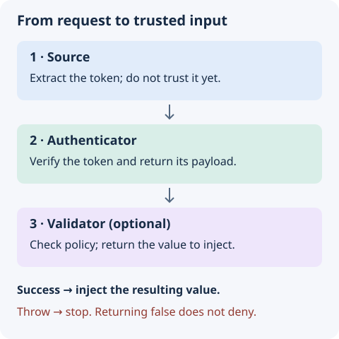

# Authentication and authorization

Authentication establishes trust in a token. Authorization decides what its holder may do. This interface connects token verification to API parameter injection; your application supplies credential checks, payload validation, and access rules.

## Authentication flow

A typical authentication flow consists of four steps:

1. **Token generation** - Sign user data into a token using `SignRaw` or `SignServerResponse`.
2. **Token transport** - Have the client send the token in the chosen header or cookie. Choose storage and CSRF protection for your client; they are not configured by this interface.
3. **Token validation** - Verify the token when the client makes a request.
4. **Authorization** - Check whether the authenticated user has permission to access the requested resource.

### Example authentication flow

The persistence functions in this example (`validateUserCredentials` and `getUserProfile`) belong to your application. The profile route verifies a token; add a validator for payload shape and resource permissions. For production cookies, also decide Secure, SameSite, expiry, and CSRF policy for your deployment.

```typescript fragment
import { SignRaw, Authentication } from "@antelopejs/interface-auth";
import {
  Controller,
  Post,
  Get,
  JSONBody,
  HTTPResult,
} from "@antelopejs/interface-api";

class UserController extends Controller("/users") {
  @Post("login")
  async login(@JSONBody() credentials: { email: string; password: string }) {
    // Validate credentials against your data store
    const user = await validateUserCredentials(credentials);

    // Step 1: Generate a token
    const token = await SignRaw(
      { userId: user.id, role: user.role },
      { expiresIn: "1h" },
    );

    // Step 2: Return token to the client
    const result = new HTTPResult(200, {
      success: true,
      user: { id: user.id, role: user.role },
    });

    result.addHeader(
      "Set-Cookie",
      `ANTELOPEJS_AUTH=${token}; HttpOnly; Secure; SameSite=Lax; Path=/`,
    );

    return result;
  }

  @Get("profile")
  async getProfile(
    @Authentication() userData: { userId: number; role: string },
  ) {
    // Step 3: Token is verified; resource authorization is application policy
    // If the token is invalid, an error is thrown before this code runs
    return { user: await getUserProfile(userData.userId) };
  }
}
```

This cookie example requires HTTPS. `SameSite=Lax` is a starting policy for same-site browser use, not a substitute for deciding CSRF protection or cross-site requirements. The helpers named above are application code, not a complete login implementation.

## Authentication sources

An `AuthSource` function extracts the authentication token from the incoming HTTP request. The default source checks two locations in order:

1. **Custom header** - The `x-antelopejs-auth` header
2. **Cookie** - The `ANTELOPEJS_AUTH` cookie

The header contains the raw token, not `Bearer <token>`. A present header takes precedence even when it is empty or invalid; authentication does not retry with the cookie after verification fails. The default source does not read `Authorization`.

### Create a custom source

Implement the `AuthSource` type to extract tokens from a different location.

```ts docs-check
import { CreateAuthDecorator, AuthSource } from "@antelopejs/interface-auth";
import type { IncomingMessage } from "node:http";

const bearerTokenSource: AuthSource = (req: IncomingMessage) => {
  const header = req.headers.authorization;
  if (header?.startsWith("Bearer ")) {
    return header.slice(7);
  }
  return undefined;
};

const BearerAuth = CreateAuthDecorator({
  source: bearerTokenSource,
});
```

The `AuthSource` type signature is:

```typescript
import type { IncomingMessage, ServerResponse } from "node:http";

type AuthSource = (
  req: IncomingMessage,
  res: ServerResponse,
) => string | undefined;
```

## Authentication verifiers

An `AuthVerifier` function validates the token and extracts its payload. The default verifier uses `ValidateRaw`, which delegates to the underlying token verification implementation (typically JWT).

### Create a custom verifier

```ts docs-check
import {
  CreateAuthDecorator,
  AuthVerifier,
  ValidateRaw,
} from "@antelopejs/interface-auth";

const userVerifier: AuthVerifier<{ userId: string }> = async (
  data,
  options,
) => {
  const payload = await ValidateRaw(data, options);
  if (typeof payload === "string" || typeof payload.userId !== "string") {
    throw new Error("Invalid user payload");
  }
  return { userId: payload.userId };
};

const UserAuth = CreateAuthDecorator({
  authenticator: userVerifier,
});
```

A verifier must establish trust in the token before returning its payload. Decoding Base64 or parsing JSON alone does not authenticate a request. `ValidateRaw` returns an `AuthClaims` (`string | JsonObject`): the interface does not know the shape of what you signed, so a field read needs a check like the one above, and the verifier's return type is what a configured validator receives as its input.

The `AuthVerifier` type signature is:

```typescript
import type { AuthClaims, VerifyOptions } from "@antelopejs/interface-auth";

type AuthVerifier<T = AuthClaims> = (
  data?: string,
  options?: VerifyOptions,
) => Promise<T> | T;
```

## Authentication validators

An `AuthValidator` function performs additional checks on the verified data. Validators run after the verifier and can transform the result or throw an error to reject the request.

```typescript
import { CreateAuthDecorator, AuthValidator } from "@antelopejs/interface-auth";

const adminValidator: AuthValidator = (claims) => {
  if (typeof claims === "string" || claims.role !== "admin") {
    throw new Error("Admin access required");
  }
  return claims;
};

const AdminOnly = CreateAuthDecorator({
  validator: adminValidator,
});
```

The `AuthValidator` type signature is:

```typescript
import type { AuthClaims } from "@antelopejs/interface-auth";

type AuthValidator<T = AuthClaims, R = unknown> = (data: T) => Promise<R> | R;
```

Without an `authenticator`, a validator receives the `AuthClaims` the default verifier returns. When you also configure an `authenticator`, the validator receives whatever that authenticator returns, so a typed verifier such as `userVerifier` above gives the validator a typed value.

## Authentication pipeline

The complete authentication pipeline processes the request through three stages:

{width="480"}

Omitted `source` and `authenticator` callbacks use the defaults. There is no default policy validator: without one, the verified payload is injected unchanged.

| Stage           | Input                          | Output               | Failure boundary                                               |
| --------------- | ------------------------------ | -------------------- | -------------------------------------------------------------- |
| `source`        | Request and response           | Token or `undefined` | Missing input still reaches the authenticator.                 |
| `authenticator` | Token and verification options | Verified payload     | A thrown error or rejected promise stops processing.           |
| `validator`     | Verified payload               | Value to inject      | Throw to deny access; a falsy return value is not a rejection. |

A validator passed to a decorator invocation replaces the configured validator; it does not run after it as an extra check. Keep shared policy in a function you explicitly call when composing validators.
